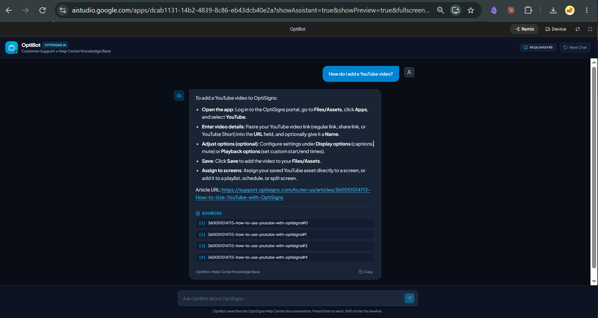
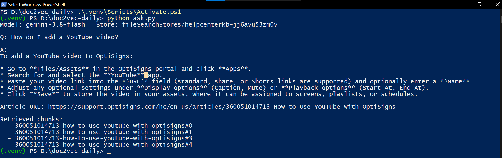

# doc2vec-daily

Daily job that mirrors a Zendesk help center into a **Gemini File Search** store and a support assistant that answers from it with cited article URLs.

```
Zendesk Help Center API ─► clean Markdown ─► heading-aligned chunks ─► Gemini File Search (delta only)
                              data/articles/*.md                          ▲
                                                           ask.py ────────┘  (assistant, verbatim system prompt)
```

## Setup

```bash
python -m venv .venv && source .venv/bin/activate   # Windows: .\.venv\Scripts\Activate.ps1
pip install -r requirements-dev.txt
cp .env.sample .env                                 # then set GEMINI_API_KEY
```

## Run locally

| Command | What it does |
|---|---|
| `python main.py` | scrape → Markdown → chunk → upload only new/changed articles; logs `added / updated / skipped` and files/chunks embedded |
| `python main.py --skip-upload` | scrape and write `data/articles/*.md` only |
| `python ask.py "How do I add a YouTube video?"` | sanity check against the store |
| `python check_store.py [keyword]` | store document counts / documents of matching articles |
| `pytest` | unit tests (converter, chunker, delta sync, scraper) |
| `docker build -t doc2vec-daily . && docker run --rm -e API_KEY=... doc2vec-daily` | one full sync, exits 0 |

## Daily job & logs

Runs on an AWS Lightsail Ubuntu instance: `cron` (`0 2 * * *` UTC) → `docker run doc2vec-daily`; each run writes its log and a JSON summary to a folder served by nginx.

- Last run log: **http://18.143.18.93/runs/latest.log**
- Last run summary: **http://18.143.18.93/runs/latest.json** · all runs: http://18.143.18.93/runs/

The job is stateless: the File Search store is the source of truth. Each chunk document carries `article_id`, `content_hash` and `chunk_index` metadata; an article is **skipped** if its hash and chunk count match, **updated** (old docs deleted, new uploaded) if not, **added** if absent, and **deleted** when unpublished. A partial failure leaves a chunk-count mismatch that the next run repairs. `UPLOAD_BATCH` (default 100) caps uploads per run.

## Scraping & cleaning

Articles come from the Help Center API (`/api/v2/help_center/{locale}/articles.json`, paginated, drafts skipped, 429/5xx retried with `Retry-After`), so bodies contain no site nav or footer. The converter then removes the repeated closing blurb ("That's all!" + contact/marketing line), spans and inline styles; turns single-column NOTE/TIP tables into blockquotes; rewrites in-page anchors (`#WhatYoullNeed` → `#what-youll-need`) so TOC links keep working; makes root-relative URLs absolute; replaces embeds with links; keeps headings, lists, tables and fenced code. Files are named `<article-id>-<slug>.md`.

## Chunking strategy

Gemini File Search caps chunks at 512 tokens, so chunks are built client-side to fit one server chunk each (~1,400 chars ≈ 400–480 tokens; 415 articles → 2,058 chunks):

1. split on `##` sections (never inside a code fence), pack small sections together;
2. split oversized sections on paragraph boundaries, repeating the heading as "(continued)";
3. prefix **every** chunk with the title and `Article URL:` line, so citations work whichever chunk is retrieved;
4. replace image links with `(Image: alt text)` (URLs cost tokens, add no meaning).

## Sanity check

Assistant set up in **Google AI Studio** (Build mode app: verbatim system prompt + File Search tool on the API-loaded store), asked "How do I add a YouTube video?":



AI Studio's Playground has no File Search tool, hence the small Build-mode app. The same check from the terminal (`python ask.py`, same prompt and store):


